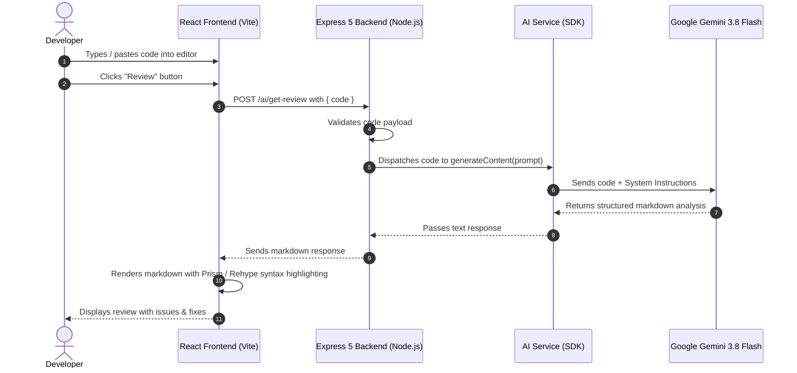

# 🤖 AI Code Reviewer

An intelligent, full-stack automated code review web application powered by **Google Gemini 3.8 Flash**, **Express 5**, and **React 19**. It functions as a virtual Senior Software Engineer (7+ years experience) that evaluates submitted source code in real-time, detecting bugs, identifying security vulnerabilities, optimizing performance, and providing clean, production-grade refactored alternatives.

---

[](https://react.dev/)
[](https://vitejs.dev/)
[](https://nodejs.org/)
[](https://expressjs.com/)
[](https://ai.google.dev/)
[](LICENSE)

---

## 📑 Table of Contents

- [1. Full Project Details](#1-full-project-details)
  - [Overview](#overview)
  - [The AI Reviewer Persona](#the-ai-reviewer-persona)
  - [System Architecture & Data Flow](#system-architecture--data-flow)
- [2. Project Features](#2-project-features)
- [3. Tech Stack Used](#3-tech-stack-used)
  - [Frontend](#frontend)
  - [Backend](#backend)
  - [AI & LLM Services](#ai--llm-services)
- [📁 Project Directory Structure](#-project-directory-structure)
- [🚀 Getting Started](#-getting-started)
  - [Prerequisites](#prerequisites)
  - [1. Backend Setup](#1-backend-setup)
  - [2. Frontend Setup](#2-frontend-setup)
- [🔌 API Reference](#-api-reference)
- [💡 Sample Review Output](#-sample-review-output)
- [🛡️ Environment Variables](#️-environment-variables)
- [🔮 Future Roadmap](#-future-roadmap)
- [🤝 Contributing](#-contributing)
- [📄 License](#-license)

---

## 1. Full Project Details

### Overview
Code reviews are a vital stage in modern software development, but manual reviews can be slow, resource-heavy, and prone to oversight. **AI Code Reviewer** bridges this gap by delivering instantaneous, senior-level code analysis directly in the browser. 

The application provides a two-pane developer dashboard:
1. **Left Pane (Code Studio):** A responsive, syntax-highlighted code editor where developers input or write their source code.
2. **Right Pane (Review Terminal):** A formatted markdown viewer that renders the AI's structured feedback with GitHub-dark syntax highlighting for code snippets.

### The AI Reviewer Persona
At the core of the backend is Google's `gemini-3.8-flash` model, guided by a specialized **Senior Code Reviewer (7+ Years of Experience)** system instruction. Rather than producing generic conversational replies, the engine adheres to strict engineering guidelines:
- **Code Quality & Maintainability:** Enforces clean architecture, DRY (Don't Repeat Yourself), and SOLID principles.
- **Error & Bug Detection:** Identifies logical flaws, promise mismatches, unhandled exceptions, and edge cases.
- **Security Compliance:** Flags vulnerabilities such as injection attacks, XSS, insecure storage, and lack of input validation.
- **Performance & Scalability:** Identifies redundant computations, expensive loops, memory leaks, and unoptimized I/O.
- **Actionable Fixes:** Always provides a concrete, syntax-highlighted refactored solution with an explanation of why the changes are beneficial.

### System Architecture & Data Flow



---

## 2. Project Features

- ⚡ **Interactive Code Editor:** Embedded, lightweight code editor built with `react-simple-code-editor` and `prismjs` for real-time JavaScript syntax highlighting.
- 🧠 **Senior AI Review Intelligence:** Powered by Google's `gemini-3.8-flash`, programmed with detailed system prompts to evaluate code like an experienced Tech Lead.
- 📋 **Structured Review Output:** Automatically formats reviews into standard industry feedback:
  - ❌ **Identified Issues & Anti-Patterns:** Pinpoints bugs, anti-patterns, and vulnerabilities with clear explanations.
  - 🔍 **Technical Root Cause Analysis:** Explains the underlying problem (e.g., asynchronous promise handling, missing error boundaries).
  - ✅ **Recommended Production-Ready Fix:** Supplies cleanly refactored code blocks ready for implementation.
  - 💡 **Optimization Insights:** Recommends modern language features, performance tweaks, and modular patterns.
- 🎨 **Rich Markdown & Code Rendering:** Built-in `react-markdown` paired with `rehype-highlight` rendering with GitHub-dark theme styles for readable diffs and code blocks.
- 🖥️ **Split-Screen Developer Workspace:** Minimalist, distraction-free side-by-side view designed for rapid code iteration.
- ⚙️ **Decoupled Architecture:** Clean separation of concerns with a modular Express backend (routes, controllers, services) and a reactive Vite frontend.
- 🌐 **CORS-Configured API:** Ready for cross-origin local development and straightforward deployment to cloud platforms (e.g., Vercel, Render, Railway).

---

## 3. Tech Stack Used

### Frontend
| Technology / Library | Version | Purpose |
| :--- | :--- | :--- |
| **[React](https://react.dev/)** | `^19.2.6` | Core component-based user interface library |
| **[Vite](https://vitejs.dev/)** | `^8.0.12` | Next-generation frontend build tool and local dev server |
| **[react-simple-code-editor](https://github.com/satya164/react-simple-code-editor)** | `^0.14.1` | Lightweight, customizable in-browser code editor |
| **[PrismJS](https://prismjs.com/)** | `^1.30.0` | Syntax highlighting engine for the editor (`prism-tomorrow` theme) |
| **[react-markdown](https://github.com/remarkjs/react-markdown)** | `^10.1.0` | Markdown parser for rendering structured AI responses |
| **[rehype-highlight](https://github.com/rehypejs/rehype-highlight)** | `latest` | Syntax highlighting plugin for code blocks within markdown |
| **[Axios](https://axios-http.com/)** | `^1.16.1` | Promise-based HTTP client for API communication |
| **Vanilla CSS3** | — | Custom split-screen styling and responsive layouts |

### Backend
| Technology / Library | Version | Purpose |
| :--- | :--- | :--- |
| **[Node.js](https://nodejs.org/)** | `>= 18.x` | JavaScript runtime environment |
| **[Express.js](https://expressjs.com/)** | `^5.2.1` | Web framework for REST API routing and middleware |
| **[@google/generative-ai](https://www.npmjs.com/package/@google/generative-ai)** | `^0.24.1` | Official Google Gemini AI SDK for Node.js |
| **[dotenv](https://www.npmjs.com/package/dotenv)** | `^17.4.2` | Loads environment variables from `.env` |
| **[cors](https://www.npmjs.com/package/cors)** | `^2.8.6` | Middleware enabling Cross-Origin Resource Sharing |

### AI & LLM Services
| Component | Specification | Description |
| :--- | :--- | :--- |
| **AI Model** | `gemini-3.8-flash` | Ultra-fast multimodal model delivering sub-second code evaluations |
| **System Prompt** | Senior Code Reviewer Persona | Custom role prompt specifying review tone, rules, and structured output |

---

## 📁 Project Directory Structure

```text
AICodeReview/
├── backend/
│   ├── src/
│   │   ├── controllers/
│   │   │   └── ai.controller.js      # Validates request and handles AI response
│   │   ├── routes/
│   │   │   └── ai.routes.js          # Defines /ai/get-review endpoint
│   │   ├── services/
│   │   │   └── ai.service.js         # Configures Gemini SDK and system prompt
│   │   └── app.js                    # Express app configuration & middleware
│   ├── .env.example                  # Template for backend environment variables
│   ├── package.json                  # Backend dependencies and scripts
│   └── server.js                     # Backend entry point (Port 3000)
│
├── frontend/
│   ├── public/                       # Static public assets (favicons, icons)
│   ├── src/
│   │   ├── App.css                   # Split-pane layout and component styles
│   │   ├── App.jsx                   # Main React component (Editor & Review panel)
│   │   ├── index.css                 # Global theme variables & typography
│   │   └── main.jsx                  # React application root entry point
│   ├── index.html                    # HTML template
│   ├── package.json                  # Frontend dependencies and Vite scripts
│   └── vite.config.js                # Vite build and plugin configuration
│
├── .gitignore                        # Global Git ignore rules
└── README.md                         # Comprehensive project documentation
```

---

## 🚀 Getting Started

Follow these steps to run the application locally on your machine.

### Prerequisites
- **Node.js** (v18.0.0 or higher recommended)
- **npm** (comes with Node.js)
- A **Google Gemini API Key** (Obtain free from [Google AI Studio](https://aistudio.google.com/))

---

### 1. Backend Setup

1. Open your terminal and navigate to the `backend` directory:
   ```bash
   cd backend
   ```

2. Install backend dependencies:
   ```bash
   npm install
   ```

3. Create a `.env` file in the `backend/` directory:
   ```bash
   cp .env.example .env
   ```

4. Open `.env` and add your Google Gemini API key:
   ```env
   GOOGLE_GEMINI_KEY=your_actual_gemini_api_key_here
   PORT=3000
   ```

5. Start the backend development server:
   ```bash
   npm run dev
   ```
   *The server starts with Nodemon on `http://localhost:3000` and automatically reloads on file changes.*

   *(Alternatively, for production, run `npm start`).*

---

### 2. Frontend Setup

1. Open a new terminal window and navigate to the `frontend` directory:
   ```bash
   cd frontend
   ```

2. Install frontend dependencies:
   ```bash
   npm install
   ```

3. Start the Vite development server:
   ```bash
   npm run dev
   ```

4. Open your browser and navigate to the local URL (typically `http://localhost:5173`).

---

## 🔌 API Reference

### Review Code Endpoint

Evaluates a snippet of code and returns markdown-formatted review feedback.

- **URL:** `/ai/get-review`
- **Method:** `POST`
- **Content-Type:** `application/json`

#### Request Body:
```json
{
  "code": "function sum() { return 1 + 1; }"
}
```

#### Response:
- **Status:** `200 OK`
- **Body:** Plaintext Markdown string containing:
  - ❌ Identified Issues
  - ✅ Recommended Fix (Code block)
  - 💡 Improvements & Technical Explanations

#### cURL Example:
```bash
curl -X POST http://localhost:3000/ai/get-review \
  -H "Content-Type: application/json" \
  -d '{"code": "function fetchData() { let data = fetch(\"/api\").then(r => r.json()); return data; }"}'
```

---

## 💡 Sample Review Output

When a snippet with asynchronous bugs or missing error handling is submitted:

```javascript
function fetchData() {
    let data = fetch('/api/data').then(response => response.json());
    return data;
}
```

The AI Code Reviewer outputs:

```markdown
❌ Bad Code:
function fetchData() {
    let data = fetch('/api/data').then(response => response.json());
    return data;
}

🔍 Issues:
• ❌ fetch() is asynchronous, but the function does not await the promise before returning.
• ❌ Missing error handling for network or HTTP error status codes.

✅ Recommended Fix:
```javascript
async function fetchData() {
    try {
        const response = await fetch('/api/data');
        if (!response.ok) {
            throw new Error(`HTTP error! Status: ${response.status}`);
        }
        return await response.json();
    } catch (error) {
        console.error("Failed to fetch data:", error);
        return null;
    }
}
```

💡 Improvements:
• ✔ Handles asynchronous control flow cleanly using modern async/await.
• ✔ Graceful error fallback prevents application crashes on API failures.
• ✔ Validates HTTP response status before JSON parsing.
```

---

## 🛡️ Environment Variables

The backend relies on the following environment variable:

| Variable | Description | Required | Default |
| :--- | :--- | :---: | :--- |
| `GOOGLE_GEMINI_KEY` | Your Google Gemini API authentication key from Google AI Studio | **Yes** | — |
| `PORT` | The port on which the Express server listens | No | `3000` |

---

## 🔮 Future Roadmap

- [ ] **Multi-Language Support:** Language selector dropdown (Python, Java, C++, TypeScript, Go, Rust).
- [ ] **One-Click Copy & Diff Viewer:** Instant copy button for suggested fixes and side-by-side diff highlighting.
- [ ] **Review History:** LocalStorage or database persistence to revisit previous reviews.
- [ ] **Custom Review Depth:** Select review mode (e.g., *Security Audit*, *Performance Optimization*, or *Quick Syntax Check*).
- [ ] **GitHub PR Integration:** GitHub Action / Webhook to review pull requests automatically.

---

## 🤝 Contributing

Contributions, issues, and feature requests are welcome!

1. Fork the Project
2. Create your Feature Branch (`git checkout -b feature/AmazingFeature`)
3. Commit your Changes (`git commit -m 'Add some AmazingFeature'`)
4. Push to the Branch (`git push origin feature/AmazingFeature`)
5. Open a Pull Request

---

## 📄 License

Distributed under the **ISC License**. See `LICENSE` for more information.
